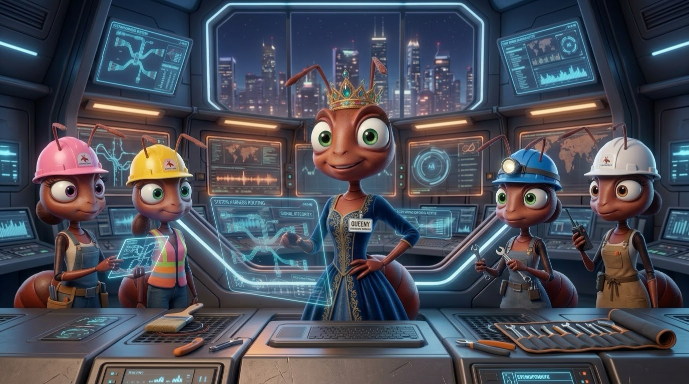
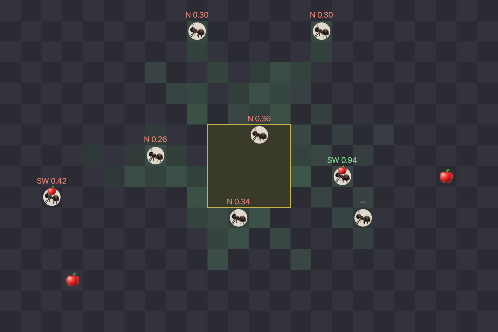

<p align="center">
  
</p>

<h1 align="center">Jev Ants</h1>

<p align="center">
  <b>An ant colony where every ant asks a decision model what to do next.</b><br>
  <b>Eine Ameisen-Kolonie, in der jede Ameise ein Decision-Model fragt, was sie als Nächstes tun soll.</b>
</p>

<p align="center">
  
  
  
  <a href="https://gkvoelkl.github.io/python-streamlit-jev-ant/"></a>
  <a href="https://github.com/gkvoelkl/python-streamlit-jev-ant/actions/workflows/docs.yml"></a>
  <a href="https://claude.com/claude-code"></a>
</p>

<p align="center">
  <a href="https://gkvoelkl.github.io/python-streamlit-jev-ant/en/">Tutorial (English)</a> ·
  <a href="https://gkvoelkl.github.io/python-streamlit-jev-ant/">Tutorial (Deutsch)</a> ·
  <a href="README_en.md">README (English)</a> ·
  <a href="README_de.md">README (Deutsch)</a>
</p>

---

## English

You are the queen of an ant colony, and your only control is a sentence. Type
“Fetch the fruit from the north”, and every ant decides for itself what that
means for it — by asking a decision model. A decision model does not answer in
prose: it picks one of the options it is given and says how sure it is.

### What you get

- **A game to try out** — a Streamlit app with eight ants on a board, fruit to
  bring home and a text field for the queen. Above every ant: what the model
  chose and how sure it was; below the board: stores, requests and cost.
- **A matching tutorial** — eight steps, each ending in a program that runs,
  plus two appendices: from an empty board to a colony that listens, and at the
  end a dice in the model's place as a yardstick. Written in German, step 1 is
  translated into English.

### Getting started

You need Python 3.12 or newer and [uv](https://docs.astral.sh/uv/).

```sh
git clone https://github.com/gkvoelkl/python-streamlit-jev-ant
cd python-streamlit-jev-ant
uv run streamlit run app.py
```

The app needs a key from [console.typesafe.ai](https://console.typesafe.ai/keys) —
or [Ollama](https://ollama.com) 0.35 or later on your own machine, with no key
and no cost.

- **Tutorial:** [website](https://gkvoelkl.github.io/python-streamlit-jev-ant/en/) · [Markdown](tutorial/en/README.md)
- **Details:** running without the cloud, the tutorial's sources, layout → [README_en.md](README_en.md)

---

<p align="center">
  
  <br><sub><em>The game after step 7 · Das Spiel nach Schritt 7</em></sub>
</p>

---

## Deutsch

Sie sind die Königin einer Ameisen-Kolonie, und Ihr einziges Steuer ist ein
Satz. Sie tippen „Holt die Früchte aus dem Norden", und jede Ameise entscheidet
für sich, was das für sie bedeutet — indem sie ein Decision-Model fragt. Ein
Decision-Model antwortet nicht in Prosa: Es wählt eine der Möglichkeiten, die
es bekommt, und sagt, wie sicher es sich ist.

### Was Sie bekommen

- **Ein Spiel zum Ausprobieren** — eine Streamlit-App mit acht Ameisen auf
  einem Brett, Früchten zum Heimbringen und einem Textfeld für die Königin.
  Über jeder Ameise steht, was das Modell gewählt hat und wie sicher es war,
  unter dem Brett Vorrat, Anfragen und Kosten.
- **Ein passendes Tutorial** — acht Schritte, jeder endet mit einem Programm,
  das läuft, dazu zwei Anhänge: vom leeren Brett bis zur Kolonie, die zuhört,
  und am Ende ein Würfel an Stelle des Modells als Maßstab. Auf Deutsch
  geschrieben, Schritt 1 ist ins Englische übersetzt.

### Loslegen

Sie brauchen Python 3.12 oder neuer und [uv](https://docs.astral.sh/uv/).

```sh
git clone https://github.com/gkvoelkl/python-streamlit-jev-ant
cd python-streamlit-jev-ant
uv run streamlit run app.py
```

Die App braucht einen Schlüssel von [console.typesafe.ai](https://console.typesafe.ai/keys) —
oder [Ollama](https://ollama.com) ab Version 0.35 auf dem eigenen Rechner, ohne
Schlüssel und ohne Kosten.

- **Tutorial:** [Website](https://gkvoelkl.github.io/python-streamlit-jev-ant/) · [Markdown](tutorial/de/README.md)
- **Details:** ohne Cloud, die Quellen des Tutorials, Aufbau → [README_de.md](README_de.md)

---

<sub>TypeSafe Jev: [typesafe.ai](https://typesafe.ai) · Port of [rust-bevy-jev-ants](https://github.com/gkvoelkl/rust-bevy-jev-ants)</sub>
